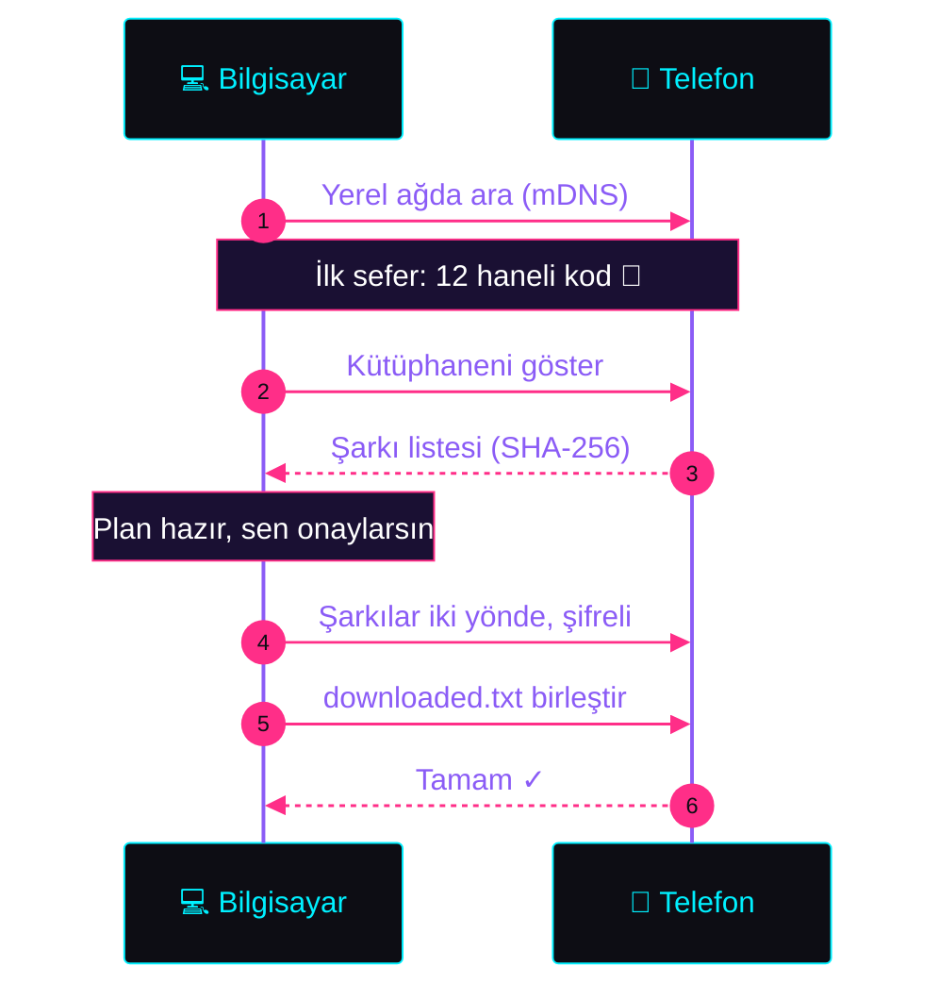

<div align="center">


<br>

<a href="../../releases/latest"></a>
&nbsp;
<a href="../../releases/latest"></a>

<p>


</p>

<p><sub>
<a href="#-neden-muzikit">Neden muzikit</a> &nbsp;✦&nbsp;
<a href="#-hızlı-başlangıç">Hızlı başlangıç</a> &nbsp;✦&nbsp;
<a href="#-linux">Linux</a> &nbsp;✦&nbsp;
<a href="#-android">Android</a> &nbsp;✦&nbsp;
<a href="#-eşitleme">Eşitleme</a> &nbsp;✦&nbsp;
<a href="#-güvenlik">Güvenlik</a> &nbsp;✦&nbsp;
<a href="#-kaynaktan-derleme">Derleme</a>
</sub></p>

</div>

<br>

> [!TIP]
> **Tek cümleyle:** YouTube linkini yapıştır, şarkı `0817 - Şarkı adı.opus` olarak kütüphanene girsin; bilgisayarda da telefonda da aynı düzenle çal, iki cihazı aynı Wi-Fi'da tek tuşla şifreli eşitle.

## ✦ Neden muzikit?

<table>
<tr>
<td width="33%" valign="top">

### ⬇️ İndir
YouTube ve YouTube Music linkleri doğrudan **Opus**'a. Sıradaki numara otomatik verilir, `downloaded.txt` sayesinde aynı şarkı iki kez inmez, hiçbir dosyanın üzerine yazılmaz.

</td>
<td width="33%" valign="top">

### ▶️ Çal
Yerleşik çalar: kuyruk, favoriler, tekrarsız karıştırma, döngü, uyku zamanlayıcısı ve gerçek **FFT** frekans analizörü. Medya tuşları ve kilit ekranı kontrolü dahil.

</td>
<td width="33%" valign="top">

### 🔄 Eşitle
Telefon ile bilgisayar aynı Wi-Fi'da buluşur, ne gidip ne geleceğini gösterir, onaylarsan **uçtan uca şifreli** aktarır. Bulut yok, hesap yok.

</td>
</tr>
</table>

### Bir bakışta

| | 🐧 Linux | 📱 Android |
|:---|:---:|:---:|
| YouTube / YouTube Music → Opus indirme, otomatik numara | ✅ | ✅ |
| `downloaded.txt` ile tekrar indirmeme | ✅ | ✅ |
| Yerleşik çalar · kuyruk · karıştırma · döngü · favoriler | ✅ | ✅ |
| Gerçek frekans analizörü (FFT) | ✅ | ✅ |
| Uyku zamanlayıcısı | ✅ | ✅ |
| Medya tuşları / kilit ekranı | ✅ MPRIS | ✅ bildirim + kilit ekranı |
| Klavye kısayolları | ✅ değiştirilebilir | ✅ harici klavye |
| Japonca, Korece vb. adlar için otomatik yazı tipi | ✅ | ✅ |
| Tema seçimi | ✅ siber · balık göleti | — |
| MP3 → Opus toplu dönüştürücü | ✅ | — |
| Sadece kulaklık modu | — | ✅ |
| Ana ekran widget'ı | — | ✅ |
| **Telefon ⇄ bilgisayar şifreli eşitleme** | ✅ | ✅ |

```text
Müzik/
├── 0815 - İlk şarkı.opus
├── 0816 - İkinci şarkı.opus
├── 0817 - Şarkı adı.opus      ← yeni şarkı her zaman sıradaki numarayı alır
└── downloaded.txt             ← indirilenlerin kaydı, tekrar inmez
```

Kütüphane düzeni iki tarafta da aynıdır. **Numaralar asla değişmez.**

<br>

## ⚡ Hızlı başlangıç

<table>
<tr>
<td width="50%" valign="top">

#### 🐧 Linux

[Releases](../../releases/latest) sayfasından `muzikit-linux-x86_64` dosyasını indir:

```bash
install -m 755 muzikit-linux-x86_64 ~/.local/bin/muzikit
muzikit
```

<sub>64 bit Linux · PipeWire (`pipewire-pulse`) · `PATH` içinde <a href="https://github.com/yt-dlp/yt-dlp">yt-dlp</a> ve <code>ffmpeg</code></sub>

</td>
<td width="50%" valign="top">

#### 📱 Android

1. [Releases](../../releases/latest) sayfasından `muzikit-android-arm64.apk` dosyasını indir.
2. Telefonda dosyayı aç → **Yükle**.
3. İlk açılışta müzik klasörünü seç.

<sub>Android 10 veya üstü · 64 bit ARM (arm64-v8a)</sub>

</td>
</tr>
</table>

<br>

## 🐧 Linux

Rust ile yazılmış, kendi penceresinde açılan (egui) masaüstü uygulaması. Siyah zemin, ince neon çerçeveler, sakin ve hareketli bir arka plan.

| Tema | Görünüm |
|:---|:---|
| **siber** | ızgara, veri akışı, radar ve 24 bantlı frekans analizörü (30 Hz – 16 kHz) |
| **balık göleti** | yukarıdan bakılan, gölgelendirilmiş ASCII balıklar; birbirine çarpmadan yüzer |

<sub>Ayarlar → görünüm. Hareketli arka plan <kbd>v</kbd> ile tamamen kapanır.</sub>

<details>
<summary><b>⬇️ İndirici</b></summary>
<br>

- YouTube ve YouTube Music linkleri; birden fazla link aynı anda (boşlukla ayır), sırayla indirilir.
- Playlist linkinde *"tamamı mı, sadece bu şarkı mı?"* sorusu.
- Dosya `NNNN - Başlık.opus` olarak sıradaki numarayla kaydedilir; var olan dosyanın üzerine asla yazılmaz.
- `downloaded.txt` ile daha önce indirilenler atlanır; yt-dlp program içinden güncellenir (`sudo` gerekmez).

</details>

<details>
<summary><b>▶️ Çalar</b></summary>
<br>

- PipeWire'a doğrudan bağlanan yerleşik ses motoru (Symphonia: Opus, MP3, FLAC, WAV, OGG, MKV).
- Sürüklenebilir ilerleme ve ses çubuğu, kuyruk (sağ tık → sıraya ekle / sıradaki), favoriler ★, son çalınanlar.
- Tekrarsız karıştırma, döngü (kapalı / liste / tek), uyku zamanlayıcısı (15–90 dk ya da şarkı sonu).
- Ses aygıtı değişince ya da akış koparsa kaldığı yerden otomatik devam.
- Medya tuşları ve KDE/GNOME medya denetimi (MPRIS), pencere küçükken de.

</details>

<details>
<summary><b>📚 Kütüphane ve araçlar</b></summary>
<br>

- Çok kelimeli arama, numara ↑↓ ya da isim sıralaması, "çalanı göster".
- Kütüphane sağlık raporu: eksik numaralar, `downloaded.txt` kaydı.
- MP3 → Opus toplu dönüştürücü (bitrate seçimi).
- Ayarlanabilir panel saydamlığı.

</details>

<details>
<summary><b>⌨️ Klavye kısayolları</b> <sub>(hepsi değiştirilebilir · eylem başına 2 tuş · Ctrl/Alt/Shift)</sub></summary>
<br>

| Tuş | Eylem | Tuş | Eylem |
|:---:|:---|:---:|:---|
| <kbd>Space</kbd> <kbd>p</kbd> | dur / devam | <kbd>/</kbd> | ara |
| <kbd>n</kbd> · <kbd>b</kbd> | sonraki · önceki | <kbd>f</kbd> | favori ekle / çıkar |
| <kbd>←</kbd> <kbd>→</kbd> | 5 sn sar | <kbd>F</kbd> | sadece favoriler |
| <kbd>Shift</kbd> + <kbd>←</kbd> <kbd>→</kbd> | 30 sn sar | <kbd>a</kbd> · <kbd>A</kbd> | sıraya ekle · sıradaki yap |
| <kbd>+</kbd> <kbd>-</kbd> | ses ±%5 | <kbd>c</kbd> | çalanı listede göster |
| <kbd>m</kbd> | sessiz | <kbd>r</kbd> | kütüphaneyi yenile |
| <kbd>s</kbd> | karıştır | <kbd>1</kbd>–<kbd>4</kbd> | indir · dönüştür · kütüphane · ayarlar |
| <kbd>d</kbd> <kbd>l</kbd> | döngü: kapalı → liste → tek | <kbd>v</kbd> | arka plan efektleri |
| <kbd>t</kbd> | uyku zamanlayıcısı | <kbd>?</kbd> | kısayol yardımı |
| <kbd>x</kbd> | durdur | <kbd>q</kbd> | çıkış (ana menüde) |

</details>

#### Komut satırı

```bash
muzikit                                # arayüz
muzikit download "https://youtu.be/…"  # doğrudan indir
muzikit convert ~/Müzik/mp3            # MP3 → Opus
muzikit check                          # kütüphane raporu
muzikit update                         # yt-dlp güncelle
```

<br>

<!-- ANDROID -->
## 📱 Android

Kotlin, Jetpack Compose ve Media3 ile yazılmış yerel uygulama. Masaüstündeki kütüphane düzenini birebir kullanır; aynı klasör iki tarafta da aynı görünür.

> [!IMPORTANT]
> **Sadece kulaklık modu:** açıkken ses yalnızca kablolu, USB ya da Bluetooth kulaklığa gider. Çalmadan önce sesin gerçekten kulaklığa yönlendiği doğrulanır, hoparlörün medya sesi 0'a çekilir; kulaklık çıkarsa müzik **anında** durur.

<details>
<summary><b>▶️ Çalma</b></summary>
<br>

- Ekran kapalıyken ve uygulama arka plandayken çalmaya devam eder; arka planda hiçbir animasyon çalışmaz.
- Bildirim ve kilit ekranından önceki/sonraki, ileri-geri sarma ve ses düzeyi.
- Ses sıfıra indirilince duraklar, ses geri gelince kaldığı yerden devam eder (isteğe bağlı).
- Telefon çaldığında ya da başka uygulama ses çaldığında durur.
- Bluetooth kulaklık bağlanınca devam eder (isteğe bağlı).
- Karıştırma, döngü (kapalı / liste / tek şarkı), kuyruk ve "sıradaki yap".
- Uyku zamanlayıcısı: 15–90 dakika ya da "şarkı bitince".
- Uygulama kapanıp açılınca son şarkı ve konum geri gelir.

</details>

<details>
<summary><b>⬇️ İndirici</b></summary>
<br>

- YouTube / YouTube Music linkinden Opus olarak indirir; birden fazla link boşlukla ayrılabilir.
- Playlist linkinde *"tamamı mı, sadece bu şarkı mı?"* diye sorar.
- Kapak resmi gömülmez, açıklama ve diğer etiketler silinir; dosya sıradaki numarayla adlandırılır.
- Daha önce indirilenler `downloaded.txt` ile atlanır. Yaş sınırlı videolar atlanır.
- Ekran kapalıyken de indirmeye devam eder. yt-dlp uygulama içinden güncellenebilir.

</details>

<details>
<summary><b>📚 Kütüphane ve görünüm</b></summary>
<br>

- Numaraya göre ↑↓ ya da isme göre sıralama, çok kelimeli arama, favoriler.
- Kütüphane sağlık raporu: numarasız dosyalar, aynı numaralı dosyalar, eksik numaralar.
- Harici klavye kısayolları (masaüstüyle aynı tuşlar) ve ana ekran widget'ı.
- Gerçek frekans analizörü (FFT, 30 Hz – 16 kHz) ve sakin, hareketli bir arka plan; ikisi de kapatılabilir.
- Akıcı kaydırma için çizimler tek zamanlayıcıdan beslenir; görünmeyen ekranda çizim yapılmaz.

</details>

<details>
<summary><b>🛡️ İzinler</b></summary>
<br>

| İzin | Neden |
|:---|:---|
| Ön plan servisi (medya, veri eşitleme) | Arka planda çalma ve indirme |
| Uyanık tutma | Ekran kapalıyken çalmanın kesilmemesi |
| İnternet, ağ durumu | İndirici ve yerel ağda eşitleme |
| Bildirim | Çalma ve indirme bildirimi |

Mikrofon, konum ya da depolama izni **istenmez**. Müzik klasörüne yalnızca senin seçtiğin klasör için Android'in klasör seçicisiyle (SAF) erişilir. Uygulamanın verileri yedeklenmez (`allowBackup=false`).

</details>
<!-- /ANDROID -->

<br>

## 🔄 Eşitleme

Aynı Wi-Fi'daki telefon ile bilgisayarın kütüphanelerini tek tuşla eşitler. Bulut, hesap ya da internet bağlantısı gerekmez.



| | Adım |
|:---:|:---|
| **1** | Telefonda **Ayarlar → bilgisayarla eşitle → eşitlemeyi aç** |
| **2** | Bilgisayarda **Ayarlar & Kısayollar → esitle → telefonu bul** |
| **3** | İlk seferde telefondaki 12 karakterlik kodu bilgisayara **bir kez** gir |
| **4** | Bilgisayar planı gösterir; sen onaylayınca uygular |

> [!TIP]
> Telefon bulunamazsa telefon ekranında yazan IP adresini bilgisayara elle girebilirsin.

**Kurallar**

- 🧬 Şarkının kimliği dosyanın **SHA-256**'sıdır; aynı şarkı iki kez taşınmaz.
- 🔢 **Var olan numaralar değişmez.** Yalnız bir tarafta olan şarkı karşıya aynı numarayla gider.
- ⚖️ İki cihaz birbirinden habersiz aynı yeni numarayı farklı şarkılara verdiyse önce eklenen numarasını korur, diğeri sona kayar (favorisi de taşınır).
- 📝 `downloaded.txt` iki tarafta aynı olur. Silinen şarkı karşı tarafta silinmez.
- 🧹 **Eşitleme geçmişini sil** tuşu (iki tarafta) eşleşmeleri sıfırlar; müziklere dokunmaz.

İki uygulama aynı algoritmayı birebir uygular ve ortak test örnekleriyle doğrulandı.

<br>

## 🔒 Güvenlik

| Katman | Koruma |
|:---|:---|
| 🌐 **Ağ** | Yalnız yerel ağ (10/8, 172.16/12, 192.168/16). Telefon yalnız eşitleme ekranı açıkken ve en fazla 10 dakika dinler; bilgisayar hiç sunucu açmaz. |
| ✍️ **Kimlik** | Her istek ve yanıt **HMAC-SHA256** ile imzalı; ±60 sn zaman penceresi, tek kullanımlık nonce. |
| 🔐 **Gizlilik** | Gövdeler **AES-256-GCM** ile şifreli; parça sırası ve kesme korumalı. |
| 🔑 **Anahtar** | 12 karakterlik koddan **HKDF** ile türetilir; 3 hatalı denemede kod yenilenir. Bilgisayarda `~/.config/muzikit/sync-key` (izin 0600), telefonda uygulamanın özel alanında. |
| 📦 **Dosya** | SHA-256 tutmayan dosya atılır; `..`, `/` ve görünmez yön karakterleri reddedilir; 100 MB sınırı; hiçbir dosyanın üzerine yazılmaz. |
| ⬇️ **İndirici** | Yalnız izinli YouTube alan adları; linkler sabit biçime çevrilir, yt-dlp'ye `--` ayırıcısı ve `--ignore-config` ile verilir. Dosya adlarından yol, kontrol ve yön karakterleri temizlenir. |
| 🎛️ **Dönüştürücü** | ffmpeg girdisi yalnız yerel dosya ve yalnız MP3 olarak açılır (`-protocol_whitelist file -f mp3`). |
| 📱 **Android** | Dışa açık bileşen yalnız başlatıcı, widget ve medya servisi; `allowBackup=false`; mikrofon, konum, depolama izni yok. |

<p>


</p>

<br>

## 🧰 Kaynaktan derleme

```text
muzikit/
├── linux/      masaüstü sürümü · Rust
└── android/    Android sürümü · Kotlin
```

```bash
# 🐧 Linux
cd linux && cargo test && cargo build --release      # → linux/target/release/muzikit

# 📱 Android  (JDK 17+, Android SDK)
cd android && ./derle.sh                              # → .build/android/app/outputs/apk/release/
```

<sub>Android: `ANDROID_HOME` (varsayılan `~/Android/Sdk`). Testler çalışır, derleme artığı `android/` klasörünün içine düşmez. Kendi imza anahtarın yoksa APK hata ayıklama anahtarıyla imzalanır.</sub>

<br>

> [!WARNING]
> YouTube'dan indirmek YouTube kullanım şartlarına aykırı olabilir; muzikit **kişisel kullanım** içindir. Android sürümündeki [youtubedl-android](https://github.com/JunkFood02/youtubedl-android) (yt-dlp, Python, FFmpeg) GPL-3.0 lisanslıdır.

<div align="center">

<sub>Linux <b>0.3.1</b> · Android <b>1.2.1</b></sub>


</div>
